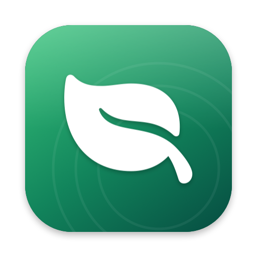
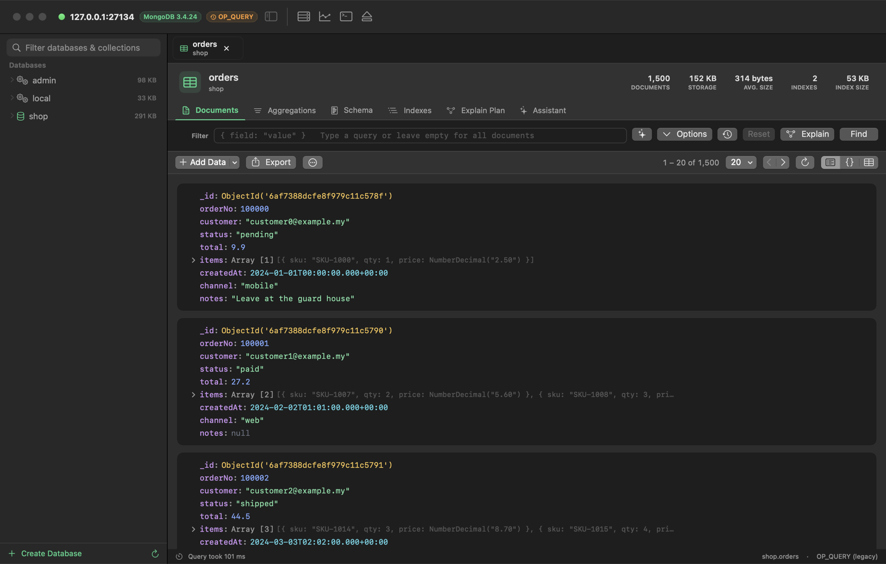
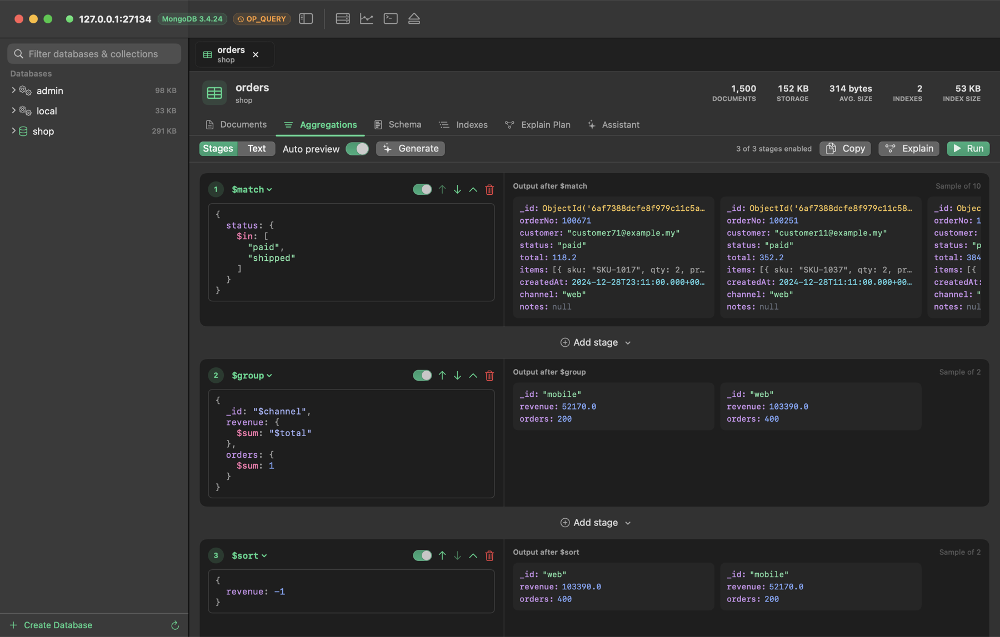
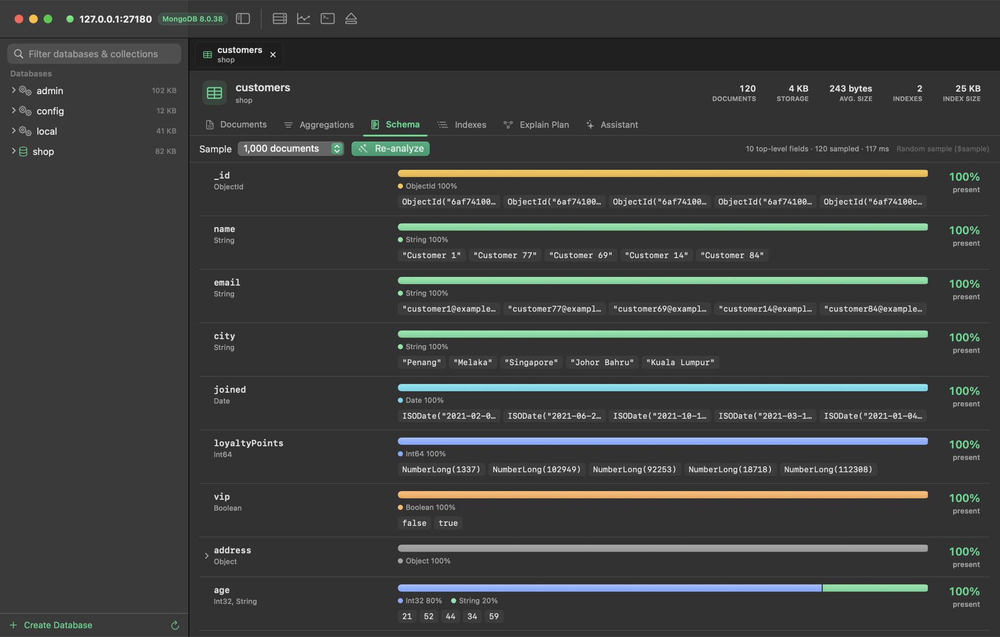
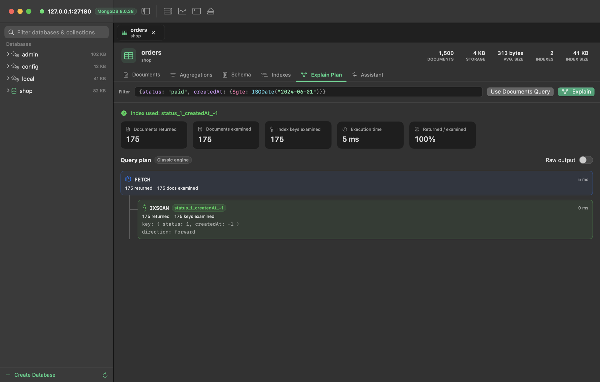
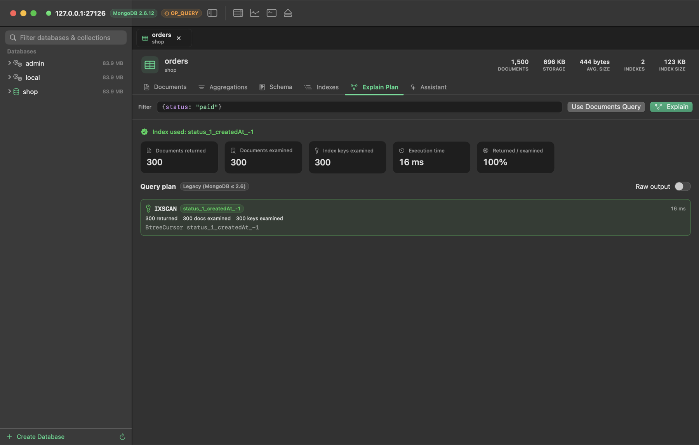
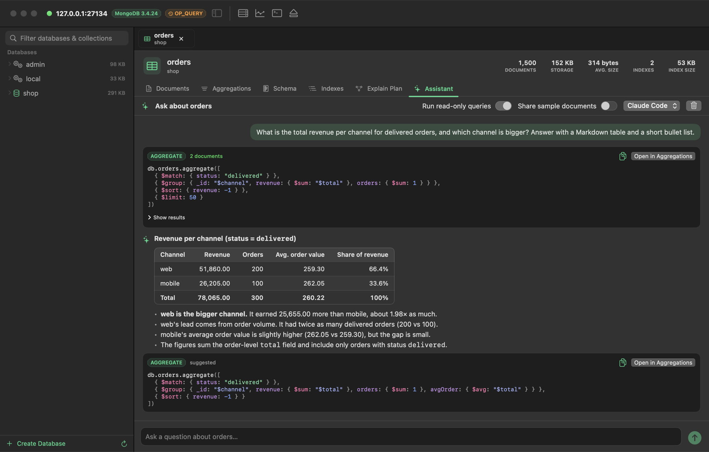
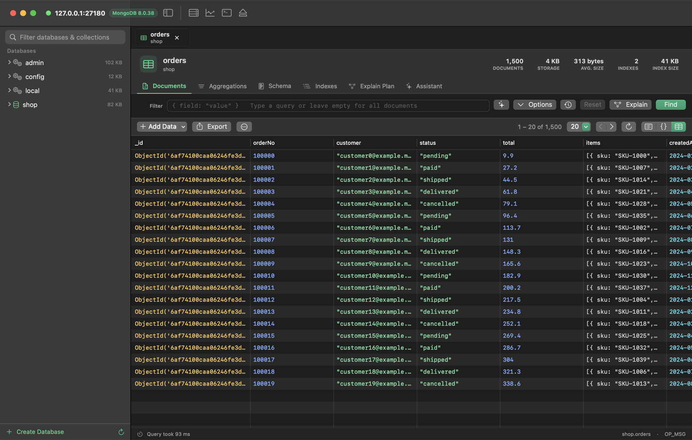

<p align="center">
  
</p>

<h1 align="center">CcinnMongo</h1>

<p align="center">
  <b>A fast, native macOS client for MongoDB — from 2.6 all the way to 8.x.</b><br>
  Browse, query, edit, aggregate, index and explain on servers that MongoDB Compass no longer supports.
</p>

<p align="center">
  <a href="https://github.com/whiteCcinn/ccinnmongo/actions/workflows/ci.yml"></a>
  <a href="https://github.com/whiteCcinn/ccinnmongo/releases/latest"></a>
  
  
  
  <a href="LICENSE"></a>
</p>

<p align="center">
  English · <a href="README.zh-CN.md">简体中文</a>
</p>

<p align="center">
  
</p>

## Why CcinnMongo?

MongoDB Compass and the official drivers dropped support for older servers, and modern drivers no longer speak the legacy `OP_QUERY` wire protocol that MongoDB 2.6 – 3.4 require. Many production systems still run those versions.

CcinnMongo ships its **own pure-Swift MongoDB stack** — BSON codec, wire protocol, authentication and version-aware operations — so the same polished UI works against every server from **MongoDB 2.6 to 8.x**. It is a native SwiftUI/AppKit app: no Electron, no bundled runtimes, no telemetry.

## Features

- **Every server generation** — automatic `OP_MSG` (3.6+) or legacy `OP_QUERY` (2.6 – 3.4), with fallbacks such as `system.namespaces`, `system.indexes` and the `$explain` modifier on old servers.
- **Authentication** — SCRAM-SHA-256, SCRAM-SHA-1, legacy MONGODB-CR and LDAP (PLAIN), negotiated automatically.
- **Connectivity** — `mongodb://` and `mongodb+srv://`, replica-set discovery and read preferences, TLS (custom CA, client certificates, legacy TLS), and **SSH tunnels** through your system OpenSSH (agent, key or password).
- **Documents** — typed tree, syntax-highlighted JSON and a fast table view; paging, counts with time limits, query history, insert / edit / clone / delete, bulk update and delete, and import/export (JSON, NDJSON, CSV).
- **Query editor** — mongo-shell syntax with `ObjectId()`, `ISODate()`, `NumberLong()`, `NumberDecimal()`, regex literals, live validation and `$operator` / field completion. Editing is type-preserving: an `Int64` stays an `Int64`.
- **Aggregations** — stage-by-stage builder with live previews after every stage, enable/disable, reorder, and a text mode.
- **Schema** — sampled field analysis with type distribution and presence.
- **Indexes** — list with sizes and usage statistics, create (compound, unique, sparse, TTL, partial, text, geo, hashed, hidden) and drop.
- **Explain plan** — summary metrics and a visual stage tree for classic, slot-based (SBE) and legacy 2.6 explain formats.
- **Server tools** — server overview, live performance charts and a command console.
- **AI assistant** *(optional)* — ask questions in plain language using your locally installed **Claude Code** or **Codex CLI**; see [AI assistant](#ai-assistant).
- **MCP server for AI clients** *(optional)* — let Claude Code, Claude Desktop, Codex and other MCP clients query the connections you enable, read-only by default; see [MCP server / AI access](#mcp-server--ai-access).
- **Secure by default** — passwords are stored in the macOS Keychain; nothing is collected or sent anywhere unless you use the AI assistant or enable MCP access.

## Compatibility

| MongoDB | Wire version | Protocol | Default authentication | Tested |
|---|---|---|---|---|
| 2.6 | 2 | `OP_QUERY` | MONGODB-CR | ✅ |
| 3.0 | 3 | `OP_QUERY` | SCRAM-SHA-1 | ✅ |
| 3.2 | 4 | `OP_QUERY` + `find` command | SCRAM-SHA-1 | ✅ |
| 3.4 | 5 | `OP_QUERY` + `find` command | SCRAM-SHA-1 | ✅ |
| 3.6 | 6 | `OP_MSG` | SCRAM-SHA-1 | ✅ |
| 4.0 – 7.0 | 7 – 21 | `OP_MSG` | SCRAM-SHA-256 | ✅ (4.0) |
| 8.0+ | 25+ | `OP_MSG` | SCRAM-SHA-256 | ✅ |

Every release is tested against real MongoDB 2.6, 3.0, 3.2, 3.4, 3.6, 4.0 and 8.0 servers. CcinnMongo runs on **macOS 14 Sonoma or later** (Apple silicon and Intel).

## Screenshots

| Aggregations with live stage previews (MongoDB 3.4) | Schema analysis (MongoDB 8.0) |
|---|---|
|  |  |
| **Explain plan (MongoDB 8.0)** | **Explain plan, legacy format (MongoDB 2.6)** |
|  |  |
| **AI assistant answering from live data** | **Table view** |
|  |  |

## Installation

1. Download `CcinnMongo-<version>.dmg` (or the `.zip`) from the [latest release](https://github.com/whiteCcinn/ccinnmongo/releases/latest).
2. Open the disk image and drag **CcinnMongo** into **Applications**.
3. The app is ad-hoc signed but not notarized. The first time, right-click the app and choose **Open**, or run:

   ```bash
   xattr -dr com.apple.quarantine /Applications/CcinnMongo.app
   ```

Each release lists SHA-256 checksums in `SHA256SUMS.txt`.

## Quick start

1. Click **New Connection**, paste a connection string such as `mongodb://user@db.example.com:27017/?authSource=admin`, or fill in the form (both stay in sync).
2. Press **Test** to check connectivity, then **Save & Connect**.
3. Pick a collection in the sidebar. Type a filter such as `{ status: "paid", total: { $gt: 100 } }` and press **Return**.

Useful shortcuts: **⌘↩** run query or pipeline · **⌘R** refresh · **⌥⌘←/→** previous/next page · **⇧⌘K** command console · **⇧⌘D** disconnect · **⇧⌘[ / ]** switch tabs.

## AI assistant

CcinnMongo can use the **Claude Code** (`claude`) or **Codex** (`codex`) command-line tool you already have installed and signed in to — no API keys to configure.

- **✨ in the query bar** turns a description ("paid orders over 100 from last month, newest first") into a filter, sort and projection.
- **Generate** in Aggregations writes a whole pipeline.
- The **Assistant** tab answers questions about your data. The agent can ask CcinnMongo to run read-only queries and then answers with the queries it used.

Prompts include the server version, so generated queries only use operators your server supports (for example, no `$expr` on 3.4).

**Privacy and safety.**
- The agent runs without tools, MCP servers or session persistence, in an empty temporary directory.
- It never receives your connection string, host names or passwords.
- CcinnMongo executes every query itself under a strict read-only policy. `$out`, `$merge`, `$where`, `$function` and `$accumulator` are rejected, results are capped at 50 documents, and each query has a 15-second limit.
- Sample documents are shared only if you enable it.

Configure the provider, model and executable path in **Settings → AI**.

## MCP server / AI access

CcinnMongo includes a [Model Context Protocol](https://modelcontextprotocol.io) server, so AI clients such as **Claude Code**, **Claude Desktop**, **Codex** or Cursor can list your connections, inspect databases and run queries through the connections you saved in CcinnMongo — on every server from MongoDB 2.6 to 8.x, including connections through SSH tunnels. The server is the app's own executable started with the `mcp` subcommand; the app does not need to be open.

1. **Enable access per connection.** Edit a connection → **AI Access** → *Read-only* or *Read & write*, or use **Settings → MCP**. Every connection starts *Disabled*.
2. **Register the server with your AI client.** **Settings → MCP** shows these snippets with the exact path of your copy of the app, with copy buttons:

   **Claude Code** (add `--scope user` to use it in every project):

   ```bash
   claude mcp add ccinnmongo -- "/Applications/CcinnMongo.app/Contents/MacOS/CcinnMongo" mcp
   ```

   **Codex** (`~/.codex/config.toml`):

   ```toml
   [mcp_servers.ccinnmongo]
   command = "/Applications/CcinnMongo.app/Contents/MacOS/CcinnMongo"
   args = ["mcp"]
   ```

   **Claude Desktop** (`claude_desktop_config.json`) and other JSON-configured clients:

   ```json
   {
     "mcpServers": {
       "ccinnmongo": {
         "command": "/Applications/CcinnMongo.app/Contents/MacOS/CcinnMongo",
         "args": ["mcp"]
       }
     }
   }
   ```

Command-line options: `CcinnMongo mcp [--profile <name|id>] [--read-only]`. `--profile` chooses the connection for calls that do not name one, and `--read-only` caps every connection at read-only access.

| Tool | What it does |
|---|---|
| `list_connections` | Connections enabled for AI access: name, id, hosts, access level, replica set, TLS, SSH. Never credentials. |
| `server_info` | Server version, wire protocol, topology, and the operators and stages this server version does not support. |
| `list_databases` | Databases with their size on disk. |
| `list_collections` | Collections and views of a database. |
| `collection_schema` | Field paths, BSON types, presence and sample values inferred from a random sample (up to 1,000 documents). |
| `list_indexes` | Index keys, options and usage counts. |
| `find` | Documents matching a filter, with projection, sort, skip and limit. |
| `aggregate` | Results of a read-only aggregation pipeline. |
| `count_documents` | Number of documents matching a filter. |
| `explain` | Execution-stats plan summary (indexes, collection scans, in-memory sorts, documents and keys examined) for a find or a pipeline. |
| `insert_one` \* | Inserts one document. |
| `update_many` \* | Applies update operators to the matching documents, bounded by `max_documents`, with `dry_run`. |
| `delete_many` \* | Deletes the matching documents, bounded by `max_documents`, with `dry_run`. |

\* Only offered when a connection has *Read & write* access and the server was not started with `--read-only`.

Filters, projections, sorts and pipelines accept Extended JSON objects (`{"_id": {"$oid": "…"}}`) or mongo-shell strings (`"{ total: { $gt: 100 } }"`). Documents come back as relaxed Extended JSON.

**Safety model.**
- AI access is off for every connection until you enable it, and `--read-only` caps all connections.
- CcinnMongo enforces read-only access itself, before anything reaches the server, instead of trusting the AI client. Read tools only build reads; `$out` and `$merge` (at any depth, including `$facet`, `$lookup` and `$unionWith` sub-pipelines), `$changeStream`, server-side JavaScript (`$where`, `$function`, `$accumulator`, code values) and credential-bearing collections (`system.users` and the copies kept by the 2.6/3.0 auth upgrade, `system.keys`, `external_validation_keys`, the oplog) are refused.
- Limits: 200 documents by default and at most 1,000 per call, about 256 KB of results (`truncated: true` when cut), and 30 seconds per call by default, at most 120 (server-side `maxTimeMS` plus a client-side deadline). Cancelling a request in the client stops the query.
- Writes exist only for *Read & write* connections. `update_many` and `delete_many` count first and change nothing when more than `max_documents` documents match (default 100, at most 10,000); `dry_run` only reports the count. This bound guards against mistakes; it is not transactional. Writes to `system.*` collections and the `local` and `config` databases are refused.
- Passwords and SSH secrets stay in the Keychain. They are never passed on the command line and never returned to the client. The MCP server is the same signed executable as the app, so it can read them without extra prompts (after an app update macOS may ask once; choose *Always Allow*).
- Every tool call is appended to `~/Library/Application Support/CcinnMongo/mcp-audit.jsonl` with the time, connection, tool, a summary of the operation, its duration, the number of documents and any error. Secrets are never logged.

## Building from source

Requirements: macOS 14+, Xcode 16 or later (Swift 6).

```bash
git clone https://github.com/whiteCcinn/ccinnmongo.git
cd ccinnmongo
swift build                       # debug build
swift test                        # unit tests
scripts/build-app.sh --open       # build dist/CcinnMongo.app and launch it
scripts/package-release.sh 1.1.0  # universal .app, .zip, .dmg and checksums in dist/
```

You can also open `Package.swift` in Xcode and run the `CcinnMongo` scheme.

### Integration tests against real servers

Docker is required. The script starts MongoDB 2.6, 3.0, 3.2, 3.4, 3.6, 4.0 and 8.0 with authentication enabled:

```bash
eval "$(scripts/it-up.sh)"        # exports CCINNMONGO_IT_URIS
swift build                       # the MCP test launches .build/debug/CcinnMongo
swift test --filter IntegrationTests
scripts/it-down.sh
```

The MCP integration test starts `CcinnMongo mcp` as a subprocess and drives a full stdio session against each server. It uses two **test-only** environment variables, which are not meant for normal use: `CCINNMONGO_PROFILE_DIR=<absolute path>` uses another data folder (profiles, history and audit log), and `CCINNMONGO_TEST_DISABLE_KEYCHAIN=1` replaces the Keychain with an empty in-memory store.

## Architecture

```
CcinnMongo (SwiftUI app, and the headless `mcp` subcommand)
 ├─ CcinnMongoMCP   MCP server on top of CcinnMongoKit: JSON-RPC over stdio, tools, read-only policy, limits, audit log
 └─ CcinnMongoKit   profiles & Keychain, query input, export/import, schema, explain, AI assistant
     └─ MongoKit    transport (Network.framework, TLS, SSH), auth, pooling, topology, version-aware operations
         └─ MongoWire   OP_MSG / OP_QUERY / OP_REPLY / OP_GET_MORE / OP_KILL_CURSORS
             └─ BSON    lossless codec, Decimal128, shell syntax & Extended JSON parser/formatter
```

- **Version-aware strategies:** strategy objects encapsulate version differences (find command vs. legacy query, `listCollections` vs. `system.namespaces`, and so on). They are selected in one place from the server's wire version.
- **Concurrency safety:** connections and pools are Swift actors, and the project builds in Swift 6 strict-concurrency mode.
- **Robust parsing:** BSON parsing is bounds-checked and depth-limited, so malformed data raises errors instead of crashing.

## The ccinn series

Native macOS database and storage tools that share the same design, speed and care:

| App | What it is |
|---|---|
| **CcinnMongo** *(this project)* | Native MongoDB client for every server from 2.6 to 8.x, with the legacy `OP_QUERY` and the modern `OP_MSG` protocols. |
| [**CcinnStarRocks**](https://github.com/whiteCcinn/ccinnstarrocks) | Native StarRocks client. Covers partitions, tablets and skew, async and sync materialized views, running tasks, and SQL with completion and charts. |
| [**CcinnRedis**](https://github.com/whiteCcinn/ccinnredis) | Native Redis client for Redis 2.8 → 8.x and Valkey, in standalone, Sentinel, Cluster and proxy deployments. |
| [**CcinnBucket**](https://github.com/whiteCcinn/ccinnbucket) | Object storage browser for Amazon S3, S3-compatible services and Alibaba Cloud OSS. |

## Contributors

- [whiteCcinn](https://github.com/whiteCcinn)

<a href="https://github.com/whiteCcinn/ccinnmongo/graphs/contributors"></a>

## Star history

[](https://star-history.com/#whiteCcinn/ccinnmongo&Date)

## Contributing

Contributions are welcome! Please read [CONTRIBUTING.md](CONTRIBUTING.md), and report security issues privately as described in [SECURITY.md](SECURITY.md).

## License

[MIT](LICENSE) © 2026 whiteCcinn. MongoDB is a trademark of MongoDB, Inc.; this project is not affiliated with or endorsed by MongoDB, Inc.
