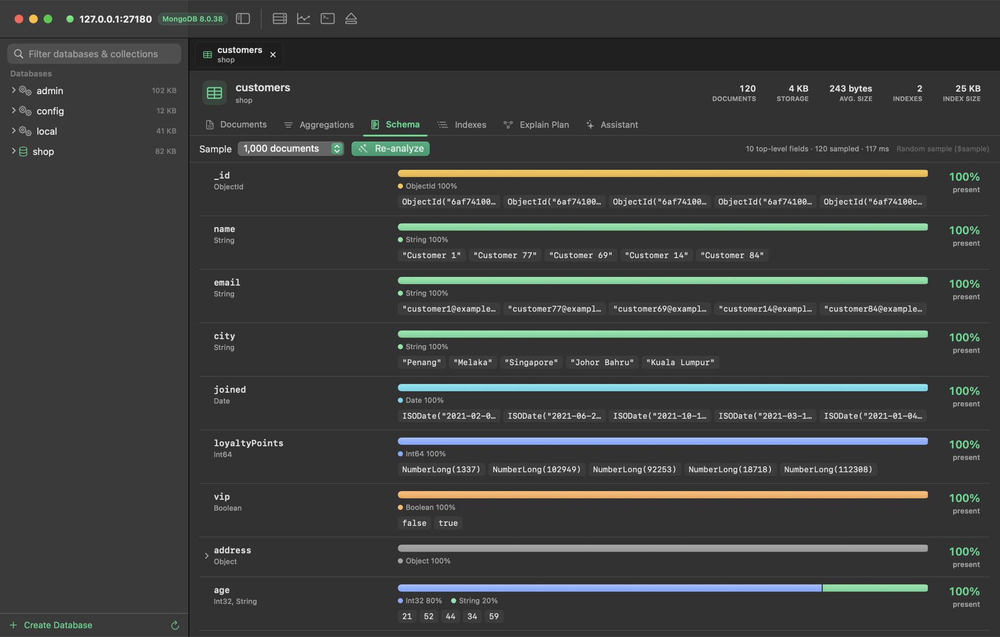
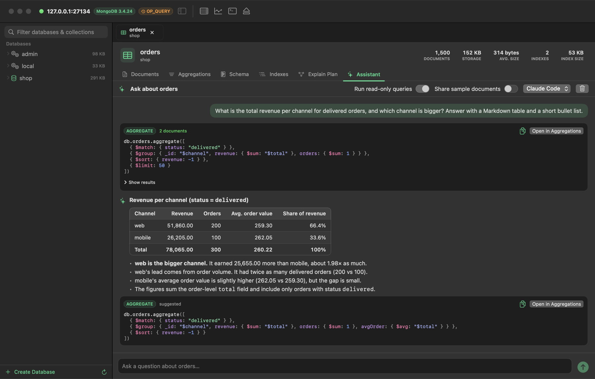

<p align="center">
  
</p>

<h1 align="center">CcinnMongo</h1>

<p align="center">
  <b>快速、原生的 macOS MongoDB 客户端 —— 从 2.6 一直支持到 8.x。</b><br>
  在 MongoDB Compass 已不再支持的服务器上，同样可以浏览、查询、编辑、聚合、管理索引和分析执行计划。
</p>

<p align="center">
  <a href="https://github.com/whiteCcinn/ccinnmongo/actions/workflows/ci.yml"></a>
  <a href="https://github.com/whiteCcinn/ccinnmongo/releases/latest"></a>
  
  
  
  <a href="LICENSE"></a>
</p>

<p align="center">
  <a href="README.md">English</a> · 简体中文
</p>

<p align="center">
  
</p>

## 为什么需要 CcinnMongo？

MongoDB Compass 和官方驱动已经放弃了对旧版本服务器的支持，新驱动也不再实现 MongoDB 2.6 – 3.4 所必需的旧版 `OP_QUERY` 线协议。但大量生产系统仍在运行这些版本。

CcinnMongo 内置了**纯 Swift 实现的 MongoDB 协议栈**（BSON 编解码、线协议、认证以及按版本自适应的操作），因此同一套精致的界面可以连接 **MongoDB 2.6 到 8.x** 的所有服务器。它是基于 SwiftUI/AppKit 的原生应用：没有 Electron、不捆绑任何运行时、没有任何遥测。

## 功能特性

- **全版本支持** —— 自动选择 `OP_MSG`（3.6+）或旧版 `OP_QUERY`（2.6 – 3.4）。在旧服务器上会使用 `system.namespaces`、`system.indexes`、`$explain` 修饰符等兼容方案。
- **认证** —— SCRAM-SHA-256、SCRAM-SHA-1、旧版 MONGODB-CR 以及 LDAP（PLAIN），自动协商。
- **连接** —— 支持 `mongodb://` 与 `mongodb+srv://`、副本集发现与读偏好、TLS（自定义 CA、客户端证书、旧版 TLS），以及通过系统 OpenSSH 建立的 **SSH 隧道**（ssh-agent、私钥或密码）。
- **文档** —— 类型化树形视图、语法高亮 JSON 视图和高性能表格视图。支持分页、带超时的计数、查询历史、插入/编辑/克隆/删除、批量更新与删除，以及导入/导出（JSON、NDJSON、CSV）。
- **查询编辑器** —— mongo shell 语法，支持 `ObjectId()`、`ISODate()`、`NumberLong()`、`NumberDecimal()` 和正则字面量，带实时校验和 `$操作符`/字段自动补全。编辑时严格保留类型：`Int64` 永远是 `Int64`。
- **聚合** —— 按阶段构建，每个阶段之后都有实时预览，支持启用/禁用、调整顺序，以及文本模式。
- **Schema 分析** —— 基于采样的字段分析，展示类型分布与字段出现率。
- **索引** —— 查看索引大小与使用统计；创建复合、唯一、稀疏、TTL、部分、文本、地理、哈希、隐藏索引；删除索引。
- **执行计划** —— 指标汇总与可视化的阶段树，兼容经典引擎、SBE 引擎以及 2.6 的旧版格式。
- **服务器工具** —— 服务器概览、实时性能图表、命令控制台。
- **多窗口** —— 每个窗口都有自己的连接：可以在另一个窗口中再次打开当前连接，在新窗口中打开已保存的连接，或者并排操作多台服务器；详见[窗口](#窗口)。
- **AI 助手**（可选）—— 用自然语言提问，借助本机已安装的 **Claude Code** 或 **Codex CLI**，详见 [AI 助手](#ai-助手)。
- **面向 AI 客户端的 MCP 服务器**（可选）—— 让 Claude Code、Claude Desktop、Codex 等 MCP 客户端查询你授权的连接，默认只读，详见 [MCP 服务器 / AI 接入](#mcp-服务器--ai-接入)。
- **默认安全** —— 密码保存在 macOS 钥匙串中。除非你使用 AI 助手或开启 MCP 访问，否则不会收集或发送任何数据。

## 兼容性

| MongoDB | 线协议版本 | 协议 | 默认认证 | 已测试 |
|---|---|---|---|---|
| 2.6 | 2 | `OP_QUERY` | MONGODB-CR | ✅ |
| 3.0 | 3 | `OP_QUERY` | SCRAM-SHA-1 | ✅ |
| 3.2 | 4 | `OP_QUERY` + `find` 命令 | SCRAM-SHA-1 | ✅ |
| 3.4 | 5 | `OP_QUERY` + `find` 命令 | SCRAM-SHA-1 | ✅ |
| 3.6 | 6 | `OP_MSG` | SCRAM-SHA-1 | ✅ |
| 4.0 – 7.0 | 7 – 21 | `OP_MSG` | SCRAM-SHA-256 | ✅（4.0） |
| 8.0+ | 25+ | `OP_MSG` | SCRAM-SHA-256 | ✅ |

每个版本都会在真实的 MongoDB 2.6、3.0、3.2、3.4、3.6、4.0 和 8.0 服务器上进行测试。CcinnMongo 需要 **macOS 14 Sonoma 或更高版本**（支持 Apple 芯片与 Intel）。

## 截图

| 聚合与逐阶段实时预览（MongoDB 3.4） | Schema 分析（MongoDB 8.0） |
|---|---|
|  |  |
| **执行计划（MongoDB 8.0）** | **执行计划，旧版格式（MongoDB 2.6）** |
|  |  |
| **AI 助手基于实时数据回答** | **表格视图** |
|  |  |

## 安装

1. 从[最新发布](https://github.com/whiteCcinn/ccinnmongo/releases/latest)下载 `CcinnMongo-<版本>.dmg`（或 `.zip`）。
2. 打开磁盘映像，将 **CcinnMongo** 拖入 **应用程序** 文件夹。
3. 应用使用 ad-hoc 签名，未经过公证。首次打开时，请右键点击应用并选择**打开**，或者执行：

   ```bash
   xattr -dr com.apple.quarantine /Applications/CcinnMongo.app
   ```

每个发布版本都附带 `SHA256SUMS.txt` 校验和文件。

### 更新

选择 **CcinnMongo → 检查更新…（Check for Updates…）**。如果有新版本，CcinnMongo 会显示更新内容。**下载并打开（Download & Open）** 会把磁盘映像保存到“下载”文件夹，按该版本的 `SHA256SUMS.txt` 校验后再打开。退出 CcinnMongo，然后把新版本拖到 **应用程序** 文件夹即可。

CcinnMongo 每天也会在后台自动检查一次，可以在 **设置 → 通用 → 更新** 中关闭。检查只访问 GitHub 的公开 Releases API，也可以选择 **跳过此版本（Skip This Version）**。

项目主页、发布说明和问题反馈入口也在 **帮助** 菜单和“关于”窗口中。

## 快速上手

1. 点击 **New Connection**，粘贴连接串（例如 `mongodb://user@db.example.com:27017/?authSource=admin`），或者直接填写表单。连接串与表单会双向同步。
2. 点击 **Test** 测试连接，然后点击 **Save & Connect**。
3. 在侧边栏选择一个集合，输入过滤条件，例如 `{ status: "paid", total: { $gt: 100 } }`，按 **Return** 执行。

常用快捷键：**⌘↩** 执行查询或管道 · **⌘R** 刷新 · **⌥⌘←/→** 上一页/下一页 · **⇧⌘K** 命令控制台 · **⇧⌘D** 断开连接 · **⇧⌘[ / ]** 切换标签页 · **⌘N** 新建窗口 · **⇧⌘N** 用当前连接新建窗口。

### 窗口

每个窗口都有自己独立的连接。你可以在一个窗口里跑耗时较长的聚合，同时在另一个窗口里看 Performance，也可以把两台服务器并排对比。

- **文件 → 新建 CcinnMongo 窗口（File → New CcinnMongo Window）**（⌘N），或连接页面上的 **新建窗口（New Window）** 按钮：打开一个停在连接页面的新窗口。
- **文件 → 用当前连接新建窗口（File → New Window with This Connection）**（⇧⌘N），或已连接窗口工具栏上的 **新建窗口（New Window）** 按钮：打开另一个以相同方式连接的窗口。它沿用当前正在使用的凭据，只保存在内存中，所以通过 `--connect` 打开的连接和没有保存的密码也能用。经由 SSH 隧道的连接会为新窗口单独建立一条隧道。
- 在已保存连接的右键菜单中选择 **在新窗口中打开（Open in New Window）**：在新窗口中连接到该连接。

关闭一个窗口只会断开这个窗口的连接。macOS 重启后重新打开的窗口会停在连接页面，不会自动连接。

## AI 助手

CcinnMongo 可以调用你本机已安装并登录的 **Claude Code**（`claude`）或 **Codex**（`codex`）命令行工具，无需配置任何 API Key。

- **查询栏中的 ✨**：把一句描述（例如“上个月金额大于 100 的已支付订单，按时间倒序”）转换成过滤、排序和投影条件。
- **聚合页的 Generate**：直接生成完整的聚合管道。
- **Assistant 标签页**：回答关于数据的问题。AI 可以请求 CcinnMongo 执行只读查询，回答时会附上它用到的查询语句。

提示词中包含服务器版本，因此生成的查询只会使用当前服务器支持的操作符（例如在 3.4 上不会使用 `$expr`）。

**隐私与安全：**
- AI 在空的临时目录中运行，且禁用工具、MCP 服务器和会话持久化。
- AI 永远拿不到你的连接串、主机名和密码。
- 所有查询都由 CcinnMongo 按严格的只读策略执行：拒绝 `$out`、`$merge`、`$where`、`$function` 和 `$accumulator`，结果最多返回 50 条文档，每次查询限时 15 秒。
- 只有在你主动开启后才会发送样例文档。

可在 **Settings → AI** 中配置提供方、模型和可执行文件路径。

## MCP 服务器 / AI 接入

CcinnMongo 内置 [Model Context Protocol](https://modelcontextprotocol.io)（MCP）服务器，**Claude Code**、**Claude Desktop**、**Codex**、Cursor 等 AI 客户端可以通过你在 CcinnMongo 中保存的连接列出连接、查看数据库并执行查询。它支持 MongoDB 2.6 到 8.x 的所有服务器，也支持经由 SSH 隧道的连接。MCP 服务器就是 App 自身的可执行文件，以 `mcp` 子命令启动，无需打开 App。

1. **按连接开启访问。** 编辑连接 → **AI Access**，选择 *Read-only*（只读）或 *Read & write*（读写），也可以在 **Settings → MCP** 中设置。所有连接默认都是 *Disabled*（关闭）。
2. **在 AI 客户端中注册服务器。** **Settings → MCP** 会按你本机 App 的实际路径生成下面这些配置，并提供复制按钮：

   **Claude Code**（加上 `--scope user` 可在所有项目中使用）：

   ```bash
   claude mcp add ccinnmongo -- "/Applications/CcinnMongo.app/Contents/MacOS/CcinnMongo" mcp
   ```

   **Codex**（`~/.codex/config.toml`）：

   ```toml
   [mcp_servers.ccinnmongo]
   command = "/Applications/CcinnMongo.app/Contents/MacOS/CcinnMongo"
   args = ["mcp"]
   ```

   **Claude Desktop**（`claude_desktop_config.json`）以及其他使用 JSON 配置的客户端：

   ```json
   {
     "mcpServers": {
       "ccinnmongo": {
         "command": "/Applications/CcinnMongo.app/Contents/MacOS/CcinnMongo",
         "args": ["mcp"]
       }
     }
   }
   ```

命令行参数：`CcinnMongo mcp [--profile <名称|id>] [--read-only]`。`--profile` 指定调用未写明连接时使用的连接；`--read-only` 把所有连接都限制为只读。

| 工具 | 作用 |
|---|---|
| `list_connections` | 已开启 AI 访问的连接：名称、id、主机、访问级别、副本集、TLS、SSH。从不返回凭据。 |
| `server_info` | 服务器版本、通信协议、拓扑，以及该版本不支持的操作符和阶段。 |
| `list_databases` | 数据库及其磁盘占用。 |
| `list_collections` | 数据库中的集合和视图。 |
| `collection_schema` | 基于随机采样（最多 1,000 条文档）推断的字段路径、BSON 类型、出现率和示例值。 |
| `list_indexes` | 索引的键、选项和使用次数。 |
| `find` | 按过滤条件查询文档，支持投影、排序、skip 和 limit。 |
| `aggregate` | 执行只读聚合管道并返回结果。 |
| `count_documents` | 统计匹配的文档数。 |
| `explain` | 查询或聚合管道的执行计划摘要（使用的索引、全表扫描、内存排序、扫描的文档数和键数）。 |
| `insert_one` \* | 插入一条文档。 |
| `update_many` \* | 用更新操作符修改匹配的文档，受 `max_documents` 限制，支持 `dry_run`。 |
| `delete_many` \* | 删除匹配的文档，受 `max_documents` 限制，支持 `dry_run`。 |

\* 仅当某个连接为 *Read & write* 且服务器未使用 `--read-only` 启动时才会提供。

过滤、投影、排序和聚合管道既可以写成 Extended JSON 对象（`{"_id": {"$oid": "…"}}`），也可以写成 mongo shell 语法字符串（`"{ total: { $gt: 100 } }"`）。文档以 relaxed Extended JSON 返回。

**安全模型：**
- 所有连接默认关闭 AI 访问，需要逐个开启；`--read-only` 会把所有连接限制为只读。
- 只读限制由 CcinnMongo 自己在请求到达服务器之前执行，而不是依赖 AI 客户端。读取类工具只会构造读操作；`$out` 和 `$merge`（任意嵌套层级，包括 `$facet`、`$lookup`、`$unionWith` 子管道）、`$changeStream`、服务端 JavaScript（`$where`、`$function`、`$accumulator`、代码值）以及含有凭据的集合（`system.users` 及 2.6/3.0 认证升级留下的副本、`system.keys`、`external_validation_keys`、oplog）都会被拒绝。
- 限制：每次调用默认返回 200 条、最多 1,000 条文档，结果约 256 KB（被截断时返回 `truncated: true`）；每次调用默认限时 30 秒、最长 120 秒（服务端 `maxTimeMS` 加客户端超时）。在客户端取消请求会终止查询。
- 只有 *Read & write* 连接才提供写入工具。`update_many` 和 `delete_many` 会先计数，匹配文档超过 `max_documents`（默认 100，最多 10,000）时不做任何修改；`dry_run` 只返回计数。这个上限用来防止误操作，不具备事务性。写入 `system.*` 集合以及 `local`、`config` 数据库会被拒绝。
- 密码和 SSH 密钥始终保存在钥匙串中，既不会出现在命令行参数里，也不会返回给客户端。MCP 服务器与 App 是同一个已签名的可执行文件，因此读取钥匙串时不会额外弹出授权提示（App 更新后 macOS 可能会询问一次，选择“始终允许”即可）。
- 每次工具调用都会追加到 `~/Library/Application Support/CcinnMongo/mcp-audit.jsonl`，记录时间、连接、工具、操作摘要、耗时、文档数和错误，从不记录任何密钥。

## 从源码构建

环境要求：macOS 14+，Xcode 16 或更高版本（Swift 6）。

```bash
git clone https://github.com/whiteCcinn/ccinnmongo.git
cd ccinnmongo
swift build                       # Debug 构建
swift test                        # 单元测试
scripts/build-app.sh --open       # 构建 dist/CcinnMongo.app 并启动
scripts/package-release.sh 1.1.0  # 在 dist/ 中生成通用二进制 .app、.zip、.dmg 和校验和
```

也可以直接用 Xcode 打开 `Package.swift`，运行 `CcinnMongo` scheme。

### 针对真实服务器的集成测试

需要安装 Docker。脚本会启动开启认证的 MongoDB 2.6、3.0、3.2、3.4、3.6、4.0 和 8.0：

```bash
eval "$(scripts/it-up.sh)"        # 导出 CCINNMONGO_IT_URIS
swift build                       # MCP 测试会启动 .build/debug/CcinnMongo
swift test --filter IntegrationTests
scripts/it-down.sh
```

MCP 集成测试会以子进程方式启动 `CcinnMongo mcp`，并针对每个服务器完成一整轮 stdio 会话。测试用到两个**仅供测试**的环境变量，日常使用请勿设置：`CCINNMONGO_PROFILE_DIR=<绝对路径>` 改用另一个数据目录（连接配置、查询历史和审计日志），`CCINNMONGO_TEST_DISABLE_KEYCHAIN=1` 用一个空的内存存储代替钥匙串。

## 架构

```
CcinnMongo（SwiftUI 应用，以及无界面的 `mcp` 子命令）
 ├─ CcinnMongoMCP   基于 CcinnMongoKit 的 MCP 服务器：stdio 上的 JSON-RPC、工具、只读策略、限额、审计日志
 └─ CcinnMongoKit   连接配置与钥匙串、查询输入、导入导出、Schema、执行计划、AI 助手
     └─ MongoKit    传输层（Network.framework、TLS、SSH）、认证、连接池、拓扑、按版本适配的操作
         └─ MongoWire   OP_MSG / OP_QUERY / OP_REPLY / OP_GET_MORE / OP_KILL_CURSORS
             └─ BSON    无损编解码、Decimal128、shell 语法与 Extended JSON 解析/格式化
```

- **版本差异封装：** 版本差异由策略对象封装（例如 `find` 命令与旧版查询、`listCollections` 与 `system.namespaces`），并且只在一处根据服务器线协议版本进行选择。
- **并发安全：** 连接与连接池均为 Swift actor，项目在 Swift 6 严格并发模式下编译。
- **健壮解析：** BSON 解析带边界检查和深度限制，遇到畸形数据会抛出错误，而不是崩溃。

## ccinn 系列

同样注重设计、速度与细节的原生 macOS 数据工具：

| 应用 | 简介 |
|---|---|
| **CcinnMongo** *（本项目）* | 原生 MongoDB 客户端，支持 2.6 到 8.x 的所有版本，同时支持旧版 `OP_QUERY` 与新版 `OP_MSG` 协议。 |
| [**CcinnStarRocks**](https://github.com/whiteCcinn/ccinnstarrocks) | 原生 StarRocks 客户端，涵盖分区、Tablet 与倾斜分析、异步/同步物化视图、运行中任务，以及带补全和图表的 SQL。 |
| [**CcinnRedis**](https://github.com/whiteCcinn/ccinnredis) | 原生 Redis 客户端，支持 Redis 2.8 → 8.x 与 Valkey，覆盖单机、Sentinel、Cluster 与代理部署。 |
| [**CcinnBucket**](https://github.com/whiteCcinn/ccinnbucket) | 对象存储浏览器，支持 Amazon S3、S3 兼容服务与阿里云 OSS。 |
| [**CcinnMysql**](https://github.com/whiteCcinn/ccinnmysql) | 原生 MySQL、MariaDB 与 Percona 客户端，支持 5.5 → 9.x：TLS 与全部认证插件、InnoDB 锁、Top 语句、复制、可视化 EXPLAIN 与安全的行内编辑。 |
| [**CcinnPsql**](https://github.com/whiteCcinn/ccinnpsql) | 原生 PostgreSQL 客户端，支持 9.6 → 18：阻塞树、索引与膨胀分析、复制与复制槽、可视化 EXPLAIN ANALYZE，并识别 PgBouncer 与 Pgpool。 |
| [**CcinnClickHouse**](https://github.com/whiteCcinn/ccinnclickhouse) | 原生 ClickHouse 客户端，支持 22.8 → 26.x：引擎族、Part 与压缩、Merge、Mutation、复制、查询日志分析与集群拓扑。 |

## 贡献者

- [whiteCcinn](https://github.com/whiteCcinn)

<a href="https://github.com/whiteCcinn/ccinnmongo/graphs/contributors"></a>

## Star 趋势

[](https://star-history.com/#whiteCcinn/ccinnmongo&Date)

## 参与贡献

欢迎贡献！请先阅读 [CONTRIBUTING.md](CONTRIBUTING.md)。安全问题请按照 [SECURITY.md](SECURITY.md) 私下报告。

## 许可证

[MIT](LICENSE) © 2026 whiteCcinn。MongoDB 是 MongoDB, Inc. 的商标；本项目与 MongoDB, Inc. 无关联，也未获得其认可。
