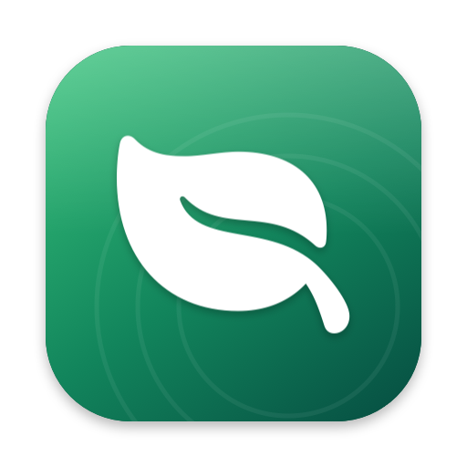
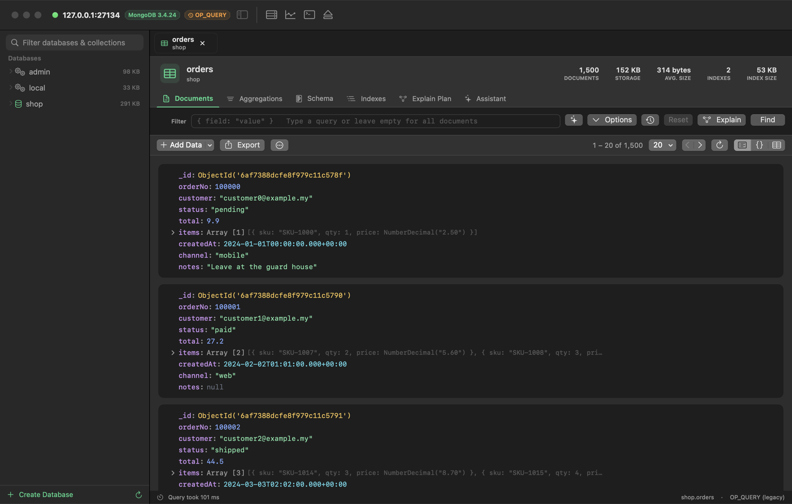
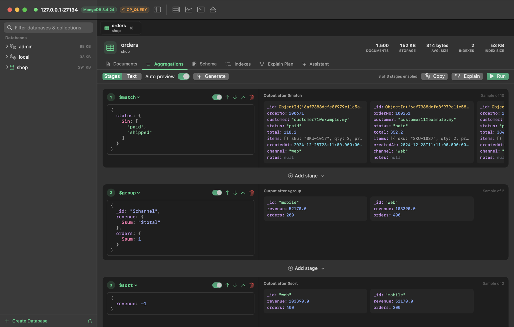
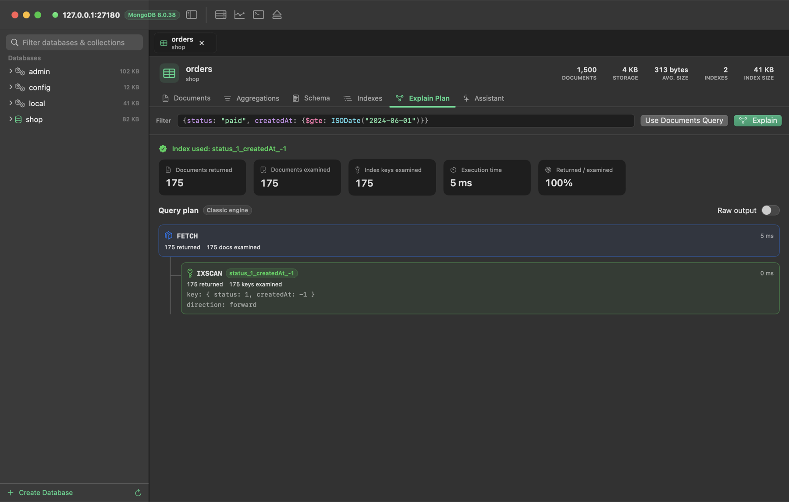
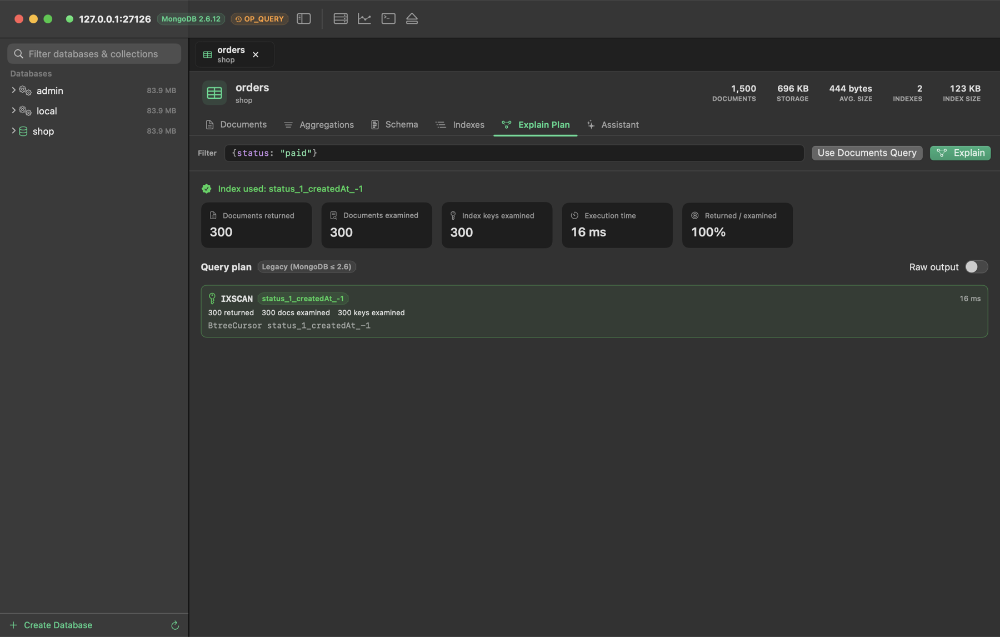
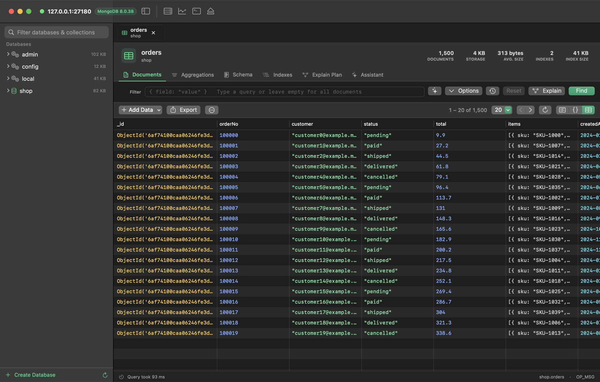

<p align="center">
  
</p>

<h1 align="center">CcinnMongo</h1>

<p align="center">
  <b>快速、原生的 macOS MongoDB 客户端 —— 从 2.6 一直支持到 8.x。</b><br>
  在 MongoDB Compass 已不再支持的服务器上，同样可以浏览、查询、编辑、聚合、管理索引和分析执行计划。
</p>

<p align="center">
  <a href="https://github.com/whiteCcinn/ccinnmongo/actions/workflows/ci.yml"></a>
  <a href="https://github.com/whiteCcinn/ccinnmongo/releases/latest"></a>
  
  
  
  <a href="LICENSE"></a>
</p>

<p align="center">
  <a href="README.md">English</a> · 简体中文
</p>

<p align="center">
  
</p>

## 为什么需要 CcinnMongo？

MongoDB Compass 和官方驱动已经放弃了对旧版本服务器的支持，新驱动也不再实现 MongoDB 2.6 – 3.4 所必需的旧版 `OP_QUERY` 线协议。但大量生产系统仍在运行这些版本。

CcinnMongo 内置了**纯 Swift 实现的 MongoDB 协议栈**（BSON 编解码、线协议、认证以及按版本自适应的操作），因此同一套精致的界面可以连接 **MongoDB 2.6 到 8.x** 的所有服务器。它是基于 SwiftUI/AppKit 的原生应用：没有 Electron、不捆绑任何运行时、没有任何遥测。

## 功能特性

- **全版本支持** —— 自动选择 `OP_MSG`（3.6+）或旧版 `OP_QUERY`（2.6 – 3.4）。在旧服务器上会使用 `system.namespaces`、`system.indexes`、`$explain` 修饰符等兼容方案。
- **认证** —— SCRAM-SHA-256、SCRAM-SHA-1、旧版 MONGODB-CR 以及 LDAP（PLAIN），自动协商。
- **连接** —— 支持 `mongodb://` 与 `mongodb+srv://`、副本集发现与读偏好、TLS（自定义 CA、客户端证书、旧版 TLS），以及通过系统 OpenSSH 建立的 **SSH 隧道**（ssh-agent、私钥或密码）。
- **文档** —— 类型化树形视图、语法高亮 JSON 视图和高性能表格视图。支持分页、带超时的计数、查询历史、插入/编辑/克隆/删除、批量更新与删除，以及导入/导出（JSON、NDJSON、CSV）。
- **查询编辑器** —— mongo shell 语法，支持 `ObjectId()`、`ISODate()`、`NumberLong()`、`NumberDecimal()` 和正则字面量，带实时校验和 `$操作符`/字段自动补全。编辑时严格保留类型：`Int64` 永远是 `Int64`。
- **聚合** —— 按阶段构建，每个阶段之后都有实时预览，支持启用/禁用、调整顺序，以及文本模式。
- **Schema 分析** —— 基于采样的字段分析，展示类型分布与字段出现率。
- **索引** —— 查看索引大小与使用统计；创建复合、唯一、稀疏、TTL、部分、文本、地理、哈希、隐藏索引；删除索引。
- **执行计划** —— 指标汇总与可视化的阶段树，兼容经典引擎、SBE 引擎以及 2.6 的旧版格式。
- **服务器工具** —— 服务器概览、实时性能图表、命令控制台。
- **AI 助手**（可选）—— 用自然语言提问，借助本机已安装的 **Claude Code** 或 **Codex CLI**，详见 [AI 助手](#ai-助手)。
- **默认安全** —— 密码保存在 macOS 钥匙串中。除非你使用 AI 助手，否则不会收集或发送任何数据。

## 兼容性

| MongoDB | 线协议版本 | 协议 | 默认认证 | 已测试 |
|---|---|---|---|---|
| 2.6 | 2 | `OP_QUERY` | MONGODB-CR | ✅ |
| 3.0 | 3 | `OP_QUERY` | SCRAM-SHA-1 | ✅ |
| 3.2 | 4 | `OP_QUERY` + `find` 命令 | SCRAM-SHA-1 | ✅ |
| 3.4 | 5 | `OP_QUERY` + `find` 命令 | SCRAM-SHA-1 | ✅ |
| 3.6 | 6 | `OP_MSG` | SCRAM-SHA-1 | ✅ |
| 4.0 – 7.0 | 7 – 21 | `OP_MSG` | SCRAM-SHA-256 | ✅（4.0） |
| 8.0+ | 25+ | `OP_MSG` | SCRAM-SHA-256 | ✅ |

每个版本都会在真实的 MongoDB 2.6、3.0、3.2、3.4、3.6、4.0 和 8.0 服务器上进行测试。CcinnMongo 需要 **macOS 14 Sonoma 或更高版本**（支持 Apple 芯片与 Intel）。

## 截图

| 聚合与逐阶段实时预览（MongoDB 3.4） | Schema 分析（MongoDB 8.0） |
|---|---|
|  |  |
| **执行计划（MongoDB 8.0）** | **执行计划，旧版格式（MongoDB 2.6）** |
|  |  |
| **AI 助手基于实时数据回答** | **表格视图** |
|  |  |

## 安装

1. 从[最新发布](https://github.com/whiteCcinn/ccinnmongo/releases/latest)下载 `CcinnMongo-<版本>.dmg`（或 `.zip`）。
2. 打开磁盘映像，将 **CcinnMongo** 拖入 **应用程序** 文件夹。
3. 应用使用 ad-hoc 签名，未经过公证。首次打开时，请右键点击应用并选择**打开**，或者执行：

   ```bash
   xattr -dr com.apple.quarantine /Applications/CcinnMongo.app
   ```

每个发布版本都附带 `SHA256SUMS.txt` 校验和文件。

## 快速上手

1. 点击 **New Connection**，粘贴连接串（例如 `mongodb://user@db.example.com:27017/?authSource=admin`），或者直接填写表单。连接串与表单会双向同步。
2. 点击 **Test** 测试连接，然后点击 **Save & Connect**。
3. 在侧边栏选择一个集合，输入过滤条件，例如 `{ status: "paid", total: { $gt: 100 } }`，按 **Return** 执行。

常用快捷键：**⌘↩** 执行查询或管道 · **⌘R** 刷新 · **⌥⌘←/→** 上一页/下一页 · **⇧⌘K** 命令控制台 · **⇧⌘D** 断开连接 · **⇧⌘[ / ]** 切换标签页。

## AI 助手

CcinnMongo 可以调用你本机已安装并登录的 **Claude Code**（`claude`）或 **Codex**（`codex`）命令行工具，无需配置任何 API Key。

- **查询栏中的 ✨**：把一句描述（例如“上个月金额大于 100 的已支付订单，按时间倒序”）转换成过滤、排序和投影条件。
- **聚合页的 Generate**：直接生成完整的聚合管道。
- **Assistant 标签页**：回答关于数据的问题。AI 可以请求 CcinnMongo 执行只读查询，回答时会附上它用到的查询语句。

提示词中包含服务器版本，因此生成的查询只会使用当前服务器支持的操作符（例如在 3.4 上不会使用 `$expr`）。

**隐私与安全：**
- AI 在空的临时目录中运行，且禁用工具、MCP 服务器和会话持久化。
- AI 永远拿不到你的连接串、主机名和密码。
- 所有查询都由 CcinnMongo 按严格的只读策略执行：拒绝 `$out`、`$merge`、`$where`、`$function` 和 `$accumulator`，结果最多返回 50 条文档，每次查询限时 15 秒。
- 只有在你主动开启后才会发送样例文档。

可在 **Settings → AI** 中配置提供方、模型和可执行文件路径。

## 从源码构建

环境要求：macOS 14+，Xcode 16 或更高版本（Swift 6）。

```bash
git clone https://github.com/whiteCcinn/ccinnmongo.git
cd ccinnmongo
swift build                       # Debug 构建
swift test                        # 单元测试
scripts/build-app.sh --open       # 构建 dist/CcinnMongo.app 并启动
scripts/package-release.sh 1.0.0  # 在 dist/ 中生成通用二进制 .app、.zip、.dmg 和校验和
```

也可以直接用 Xcode 打开 `Package.swift`，运行 `CcinnMongo` scheme。

### 针对真实服务器的集成测试

需要安装 Docker。脚本会启动开启认证的 MongoDB 2.6、3.0、3.2、3.4、3.6、4.0 和 8.0：

```bash
eval "$(scripts/it-up.sh)"        # 导出 CCINNMONGO_IT_URIS
swift test --filter IntegrationTests
scripts/it-down.sh
```

## 架构

```
CcinnMongo（SwiftUI 应用）
 └─ CcinnMongoKit   连接配置与钥匙串、查询输入、导入导出、Schema、执行计划、AI 助手
     └─ MongoKit    传输层（Network.framework、TLS、SSH）、认证、连接池、拓扑、按版本适配的操作
         └─ MongoWire   OP_MSG / OP_QUERY / OP_REPLY / OP_GET_MORE / OP_KILL_CURSORS
             └─ BSON    无损编解码、Decimal128、shell 语法与 Extended JSON 解析/格式化
```

- **版本差异封装：** 版本差异由策略对象封装（例如 `find` 命令与旧版查询、`listCollections` 与 `system.namespaces`），并且只在一处根据服务器线协议版本进行选择。
- **并发安全：** 连接与连接池均为 Swift actor，项目在 Swift 6 严格并发模式下编译。
- **健壮解析：** BSON 解析带边界检查和深度限制，遇到畸形数据会抛出错误，而不是崩溃。

## 参与贡献

欢迎贡献！请先阅读 [CONTRIBUTING.md](CONTRIBUTING.md)。安全问题请按照 [SECURITY.md](SECURITY.md) 私下报告。

## 许可证

[MIT](LICENSE) © 2026 whiteCcinn。MongoDB 是 MongoDB, Inc. 的商标；本项目与 MongoDB, Inc. 无关联，也未获得其认可。
